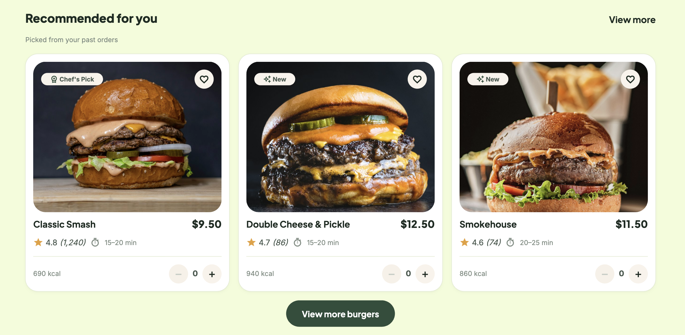

<p align="center">
  
</p>

# Burger Shop: an md2ui demo

A web shop whose pages are an agent's replies, rendered by md2ui. A native header and footer
sit around one `<md2ui-view>`; the agent (Claude) answers every request with an md2ui page
in the shop's own theme. All services are mocked.



```
web/ (Vite + TS)  ==md2ui's WebSocket==>  backend/main.py (FastAPI)  -->  Claude (claude-opus-5-5)
  header (logo)       (@md2ui/wire)          │  agent loop, tools.py
  <md2ui-view>      --/api-->                ├─> shop.py      mock catalog, cart, likes, checkout, orders
  footer (total, View cart,                  ├─> pages.py     md2ui pages from live data ({{includes}})
   Checkout) + prompt bar                    ├─> md2ui        Conversation + socket: draws the includes,
  sandbox payment window                     │                verifies and answers taps, words the rest
app/ (Flutter): the same, its view           └─> /theme       THEME.md + fonts for the view
  a web view whose page opens the socket
```

## Layout

| Path | What |
|---|---|
| `backend/md2ui_theme/THEME.md` | The look: palette, Plus Jakarta Sans and Inter, cards, chips, buttons, icon badges |
| `backend/md2ui_theme/MEANINGS.md` | The contract: what each spelling means in this shop |
| `backend/md2ui_theme/patterns/` | 16 patterns: home (headline, offer cards, home orders, product cards, deal rows, track card), catalog, product details, cart, checkout, order success, order status, order history, cancel order, empty state |
| `backend/data/products.json` | Mock data: 17 products (burgers and shakes with sizes), 3 promotions, the headline |
| `backend/data/past_orders.json` | The demo customer's history: 6 orders over the last month, 2 of them cancelled |
| `backend/shop.py` | Mock services. Orders move through received → preparing → on the way → delivered on a clock, can be cancelled before a rider picks them up, and feed the recommendations |
| `backend/pages.py` | Every page as md2ui Markdown, in the patterns' exact spellings, and the registry of `{{include}}`s md2ui draws |
| `backend/tools.py` | Agent tools, system prompt, the `open_checkout` client tool |
| `backend/socket_door.py` | The shop's one-time ticket, checked before md2ui's socket opens |
| `backend/main.py` | FastAPI: md2ui's `Conversation` and socket per conversation, its handlers (➕ ➖ 🤍 ❤️, and the taps that only choose a page), the agent's turns, the app endpoints, the theme |
| `backend/tests/` | Shop, sizes, pages (each passes `md2ui check`), taps md2ui answers, commit presses, the socket, its ticket and the embed's origin, order feeds, order redraws, API with a scripted Claude |
| `web/` | The page: `src/main.ts` (the chrome, where taps go), `src/wire_view.ts` (the view on md2ui's socket, shared with the embed), `src/checkout.ts` (payment window), `src/api.ts` (the shop's HTTP side) |
| `IMAGES.md` | Every Unsplash photo, its page and photographer |
| `app/` | The same demo as a Flutter app for iOS and Android: native header, footer and payment sheet around the md2ui view. See `app/README.md` |
| `web/embed.html`, `web/src/embed.ts` | The page the app's web view shows: one `<md2ui-view>` on md2ui's socket, with a ticket the app asks for, and its bridge to the native chrome; built into `app/assets/md2ui` |
| `docs/pattern-renders/` | Each pattern rendered at 1120 and 390 px (`scripts/render_patterns.py`) |
| `backend/order_feeds.py` | A running order on screen moved by md2ui's feeds: the shop opens one per running order a page shows, and posts its stage, arrival and progress as the order moves; then asks md2ui to redraw the includes that draw orders (`Conversation.changed`), for the badge, updates and actions no slot holds |

## Keeping the agent's work small

- **Pages are includes.** The agent writes `{{cart}}`, `{{home}}`, `{{menu category=burgers}}`,
  `{{cards classic-smash bacon-bbq}}` or `{{order}}`. md2ui swaps each line for the
  page's Markdown, built from live data by `pages.py`, before the window sees it. A page costs one
  short line and no tool call. Prices and counts are always the shop's. The agent writes
  its own Markdown only for answers no include covers, and can mix includes into them.
- **Taps on ➕ ➖ 🤍 ❤️ never reach the agent.** md2ui verifies the tap against the page it sent
  and runs the shop's handler, which changes the cart or the likes and names the includes that
  draw them; md2ui draws those includes again and sends the page as a replacement. The footer
  updates in under a second. A stepper the agent typed itself, outside an include, is not
  redrawn: pages take their rows from `{{cards …}}` or `{{rows …}}`.
- **Neither do taps that only choose a page.** A category tab, Keep shopping, Best sellers,
  Under $10 (`agent:catalog?…`), a View cart or My orders link on the page: the shop's handler
  answers `Show("{{menu category=sides}}")` and md2ui sends that page of includes (ADR-614).
  The header's My orders and the footer's View cart are the app's own buttons, not the page's:
  `/api/nav` shows the page. A catalog tap the menu page cannot answer (`filter=spicy`) is
  the agent's.
- **The agent still knows.** Its next turn starts with `[App notes]`: md2ui's digest of the
  taps it answered (one line each), the cart as it is now, what md2ui does not see (the app's
  payments and pages, the home page shown), and md2ui's issues with the agent's last page
  (`reply_issues`, told the includes and the handled slugs), errors and warnings and its advice.
- **Few tools, one call each:** `find_products`, `get_product`, `get_cart`,
  `update_cart` (several items at once), `set_like`, `get_order`, `get_orders` (the history
  with the usual spend and items), `get_recommendations` (what to order again and what to try,
  each with a reason), `cancel_order`, `reorder` (a past order back into the cart), and the
  client tool `open_checkout`.

## md2ui showcase

What the shop shows of md2ui:

- **Includes.** The agent's pages are `{{…}}` lines md2ui draws from the shop's live data
  (above; md2ui ADR-612).
- **md2ui's wire.** The web page and the Flutter app's embed page both talk to md2ui's own
  WebSocket (`wire_server.build_app`, one per conversation) through md2ui-ts's wire client
  (`@md2ui/wire`, in `web/src/wire_view.ts`); md2ui verifies every tap against the page it sent
  and words the rest for the agent (ADR-601). The socket opens behind the shop's one-time
  ticket (below).
- **Handled taps.** ➕ ➖ 🤍 ❤️ are answered by the shop's md2ui handlers: a tap changes the cart
  or the likes and md2ui redraws the includes it names, with no agent turn (ADR-612); a tap that
  only chooses a page shows it (ADR-614). md2ui teaches a held count (`Quantity: ➖ [2/9] ➕`) instead of
  ➖ ➕ buttons, because a button that comes back to the agent costs a turn; these never come
  back, so they stay buttons on cards, rows and the cart, and the patterns say why.
- **Sizes.** Burgers come Single, Double or Triple, shakes Regular or Large; each product's
  listed price is its default size's. A cart line is a product at one size, and a stepper names
  its line: `agent:cart-add?id=classic-smash&size=triple`. A bare stepper (`?id=classic-smash`,
  on cards, deal rows and the catalog) is the default size; cart rows spell their size and show it
  as a second tag (`` `Burger` *`Triple`* ``). `{{product classic-smash size=triple}}` opens the
  product page at a size.
- **The product page is a form** (md2ui ADR-405, pattern `product-details`): the size as a choice
  (`md2ui.choice=size`, ` | ` between the options), the quantity as a count
  (`Quantity: ➖ [1/9] ➕`), and one `Add to cart` press (`md2ui.commit=1`). Choosing and counting
  wake nobody: md2ui records them, and the press carries what changed (the wire's `vs`) in one
  turn. md2ui checks each value against the page it sent and hands the agent its own sentence:
  `User chose "Add to cart": add {id: classic-smash, size: double}, with size: "Triple", "Quantity" at 4 (message m3)`.
  The button names the size shown, so a press that changed nothing (`with no change`) still says
  which line it adds.
- **Order status by feeds** (md2ui ADR-608). A running order's stage chip, arrival time and
  progress bar move on the page on screen as the order moves, with no agent turn
  (`backend/order_feeds.py`). md2ui redraws the rest of what the
  page draws of the order (its badge, updates list, Cancel button) as it moves
  (`Conversation.changed`, ADR-612), with no agent turn either.


## A home page written fresh each time

The band and the three cards under it are the agent's, in new words every time home is shown:
a greeting for the moment, with no name ("Good evening, what are you craving?"), one true line (the running
order, the usual, what's new), its main action, and three cards that are three reasons to tap
(the usual or the running order, something new for them, a live promotion). The rest of the
page is live data.

- **The four coloured cards (the band and the three cards) are for products only:** what to
  eat, what's new, what's on offer. Their buttons can only be product actions (product,
  cart-add, offer, offers, catalog, picks); the server refuses order actions there.
- **Orders have their own section,** "Your orders", under the cards: the running order's
  status card, the last order, and a panel suggesting to order the usual again. The agent
  writes that panel's line each time (`{{home-rest note="Same again for Friday night?"}}`).
- The agent writes includes with its words as parameters:
  `{{headline greeting="…" line="…" image=<id> cta="…" action=…}}`, three
  `{{offer product=<id>|promo=<id> kicker="…" title="…" chip="…" cta="…"}}` lines, then
  `{{home-rest}}`. The server keeps the layout: it numbers and colours the cards, picks each
  photo, strips stray Markdown from the words, refuses actions that aren't `agent:` links, and
  leaves featured products out of the recommendations below.
- **Fast first page:** the window never waits for the agent to see home. `POST /api/home` returns
  at once (about 0.1 s) a home personalised from live data in the shop's own words
  (`pages.instant_includes`: "Good evening, what are you craving?", the usual burger, something new, a promotion).
  The window then asks `POST /api/home/fresh`, and the **home writer** (`backend/home_writer.py`)
  writes the band, cards and note in new words. It's a small call beside the conversation: a
  short prompt, no tools, low effort, its session kept warm from server start, and it remembers
  its recent greetings so it doesn't repeat them. The fresh page swaps in place when ready,
  4–5 s later on a warm writer. Taps on ➕ ➖ 🤍 ❤️ work meanwhile; any other tap cancels the swap.
  Bad output (not exactly the five include lines, an order action in a card) keeps the instant
  page. The conversation's agent is told what the window shows.
- **Written once a session.** The fresh home's words are saved for the session; the tab keeps
  its id, so a reload is the same session. Every later Home (the logo, Back to home, a reload)
  shows the saved words at once, with no writer call, while its live parts are rebuilt from
  data: the orders section, the steppers, the recommendations. The saved words are replaced
  when:
  - the part of the day changes (a new home is written);
  - the order the orders line was written for moves on (that line alone falls back to the
    section's own);
  - the agent writes a whole new home, e.g. when asked for something different on it. Its
    version becomes the saved one. For a plain "take me home" the agent replies
    `{{home-saved}}`.
- **What it writes from:** `[Home context]`, attached by the server to any turn that asks for
  home (the first visit, the logo, Home). It holds the weekday, time and part of
  the day, the usual items, what to try next, the last and running orders, what's new and on
  offer, the promotions and the likes (also the `get_home_context` tool). No tool round trip
  is needed, so a fresh home takes about 6–9 s.
- **Rules in the prompt:** never the same words twice in a conversation; only facts from the
  context; no invented urgency ("tonight only"). `{{home}}` remains as the fallback.
- **Customer:** `backend/data/customer.json`: an address and no name, since everyone trying the demo
  is this customer; greetings speak to the moment, never to a person.

## Past orders, recommendations, cancelling

- **History:** "My orders" (in the header, or asked in words) is `{{orders}}`: every order as a
  tappable card with its status chip, then the customer's usual items and new ones to try.
- **Recommendations** come from the history. The products ordered most come back as "Your
  usual"; products never ordered, close to those, appear as "Something new to try" with a
  reason. The home page's recommendations lead with the usual burger. Cancelled orders don't
  count.
- **Cancelling:** an order can be cancelled while it is received or preparing (two order
  steps, 4 minutes by default). Its page offers Cancel order, which asks first (`{{cancel …}}`,
  a sheet with a destructive button). Only the confirmation makes the agent call
  `cancel_order`; the payment goes back to the card. An order on the way or delivered says
  why it can't be cancelled.

## Checkout

- **The app's own:** the footer's Checkout and the page's Checkout (both apps catch
  `agent:checkout` before it is sent) open the window, or the Flutter app's native sheet, on
  the app's own session. When the payment goes through the app asks for the confirmation
  (`/api/nav`, `{{success}}`), and the agent is told both in its app notes. No agent turn.
- **The agent's:** when the customer asks in words, the agent calls `open_checkout`. The loop
  pauses with the order review on screen; the app learns of it from `/api/state` after that
  page, opens the window or the sheet, and `/api/resume` hands the agent the outcome from the
  server's checkout session. The window's own claim is never trusted.
- **The card number** goes only to `/api/checkout/{id}/pay`. The shop keeps the brand and
  the last four digits, and the agent sees neither the number nor the form.
  `4242 4242 4242 4242` pays, `4000 0000 0000 0002` is declined.

**How a tap is resolved.** md2ui-ts reports a tapped target by the page shown and its ordinal,
never its query (`?id=…`); the app sends exactly that (md2ui's event frame), and md2ui resolves
it against its own copy of the page it sent. A tap on a page that is gone, a target out of range
or a drifted slug is refused.

## Run

Requires Python 3.13+, Node 24 with pnpm 10, and uv (for the venv below, and to redraw the logo
and icons). md2ui comes from PyPI and npm, pinned to its first experimental release:
`md2ui==0.1.0a1` in `backend/requirements.txt`, and `@md2ui/dom` and `@md2ui/wire`
`0.1.0-alpha.1` in `web/package.json`.

**md2ui in the backend.** The backend imports md2ui (its `Conversation`, includes and
handlers), installed by `requirements.txt`. md2ui needs Python 3.13+ and installs its
renderer's dependencies too (`skia-python`, `glfw`, wheels for macOS and Linux), though the
backend only groups Markdown and never draws.

The backend's venv needs Python 3.13 or newer, which md2ui requires: create it with
`uv venv --python 3.13 .venv` or `python3.13 -m venv .venv`, not a bare `python3` that may be
older.

```bash
# backend
cd backend
uv venv --python 3.13 .venv && uv pip install -p .venv -r requirements.txt
#   or: python3.13 -m venv .venv && .venv/bin/pip install -r requirements.txt
.venv/bin/pytest                       # no API key needed
cp .env.example .env                   # then set ANTHROPIC_API_KEY, or see "Choose how the agent runs"
DEMO_SEED_ORDER=1 .venv/bin/uvicorn main:app --env-file .env --port 8000

# web (another terminal)
cd web && pnpm install && pnpm dev     # http://localhost:5173
```

The page must be served from an origin the backend names: `ALLOWED_ORIGINS` (comma-separated,
default `http://localhost:5173,http://localhost:8787`: the web app's dev server and the Flutter
app's embed page). On another port, start both with it:
`ALLOWED_ORIGINS=http://localhost:5181 .venv/bin/uvicorn main:app --port 8000` and
`pnpm dev --port 5181`. The dev server proxies `/api`, `/theme` and the socket (`/md2ui`).

**Settings.** The backend reads its settings from the environment. `backend/.env.example`
lists every one with its default; `--env-file .env` loads your copy (through `python-dotenv`),
and a variable set in the shell wins over the file. `.env` is gitignored: keep keys there, never
in the example.

**`BACKEND_URL`** (default `http://127.0.0.1:8000`) is where the web dev server sends `/api`,
`/theme` and the socket (`web/vite.config.ts`). Export it in the shell that runs `pnpm dev`, for
a backend on another port or host: `BACKEND_URL=http://127.0.0.1:8001 pnpm dev`. Vite does not
load `.env` files into `process.env` for its config, so a `web/.env` has no effect on it.

The Flutter app (`app/`) uses this same server: see `app/README.md`. For a phone, start the
backend with `--host 0.0.0.0`.

### Choose how the agent runs

Two ways, chosen with `AGENT_RUNTIME`. Both run the same agent: the same tools, prompt, pages
and home writer. Only who answers, and how you pay for it, changes.

| | `AGENT_RUNTIME=api` (default) | `AGENT_RUNTIME=claude-code` (dev only) |
|---|---|---|
| Runs on | The Claude API, through the Anthropic SDK | Your local Claude Code login, through the Claude Agent SDK |
| You need | An API key, or a signed-in `ant` profile | Claude Code installed and signed in (`claude`, then `/login`) |
| Billed to | The API account | Your Claude subscription or Claude Code plan |
| Use it for | Anything shared: a demo others use, a deployed server | Trying the demo on your own machine with no API key |
| Extras | Prompt caching, refusal fallbacks (`fallbacks: "default"`), per-turn effort | Each conversation and the home writer keep a Claude Code process running |

**With an API key:**

Set `ANTHROPIC_API_KEY` in `backend/.env`, or in the shell:

```bash
export ANTHROPIC_API_KEY=sk-ant-...
DEMO_SEED_ORDER=1 .venv/bin/uvicorn main:app --port 8000
```

No key in the environment? The SDK also finds a profile from `ant auth login` (the Anthropic
CLI); `ant auth status` shows which one is active. A set `ANTHROPIC_API_KEY` wins over a
profile.

**With your Claude Code login:**

```bash
claude            # once: sign in with /login, then quit
AGENT_RUNTIME=claude-code DEMO_SEED_ORDER=1 .venv/bin/uvicorn main:app --port 8000
```

It's for your machine only: never expose a server in this mode to other people's traffic. The
agent gets only the shop's tools (no shell, files or web), and no settings, `CLAUDE.md` or
skills of yours are loaded. Not available in this mode: per-turn effort for the conversation's
agent (`CLAUDE_EFFORT`), refusal fallbacks and prompt-cache control.

**Which model:**

| Setting | Default | Used by |
|---|---|---|
| `CLAUDE_MODEL` | `claude-opus-5-5` | the conversation's agent, with `api` |
| `CLAUDE_CODE_MODEL` | `claude-opus-5-5` | the conversation's agent, with `claude-code` |
| `CLAUDE_EFFORT` | `medium` | the conversation's agent, with `api` |
| `HOME_MODEL` | `CLAUDE_MODEL` | the home writer, in both modes |
| `HOME_EFFORT` | `low` | the home writer, in both modes |

`GET /api/health` says which mode is running (`runtime`).

**Not supported:** OpenAI / ChatGPT API keys and the Codex CLI. The agent loop, the home
writer and the tool schemas are written for the Anthropic SDK. Either would be a new
`AGENT_RUNTIME` beside these two, sharing the shop, the pages, the prompt and the md2ui notes.

### Other settings

| Env | Default | Does |
|---|---|---|
| `DEMO_SEED_ORDER` | off | `1` starts with an order on its way, so home shows its tracking card |
| `ORDER_STAGE_SECONDS` | `120` | How long each order step takes; an order can be cancelled for its first two steps |

After changing the theme, or md2ui's pins (then reinstall):

```bash
scripts/sync_md2ui.sh                                  # the agent's md2ui notes + theme lint
backend/.venv/bin/python scripts/render_patterns.py    # re-render the pattern screenshots
uv run web/scripts/make_logo.py                        # the logo, if its font or icon changed
```

## Demo gaps (by design)

- State is in memory and single-customer: restarting the backend resets the cart and orders.
- The delivery address is fixed, and "change address" is only a request the agent answers.
- No authentication beyond the socket's ticket, and conversations never expire.

## md2ui's WebSocket: the shop's door

Both apps' pages talk to md2ui's own socket (`wire_server.build_app`), and md2ui authenticates
no one (md2ui `protocol/backend.md`, ADR-603). The shop brings two things:

- **The page's origin, by name.** md2ui's socket refuses a browser page whose origin it was not
  given, `localhost` pages included. The backend passes `ALLOWED_ORIGINS` to `build_app`; name
  the shop's real origin when deployed. The Flutter app's embed page is a browser page too: its
  web view loads it from the app's own page server, so its socket carries the page's origin,
  `http://localhost:8787`, not a custom scheme or `null` (as the app's macOS WKWebView sends
  it; iOS's WKWebView and Android's Chromium WebView send a page's origin the same way, unchecked
  on a phone). Any page on that phone served from that
  port shares the origin, which is why the ticket, not the origin, is the door.
- **A one-time ticket** (`backend/socket_door.py`). The web page asks `POST /api/session` for
  one, same-origin; the embed page asks the app, which asks the shop over its own HTTP (the
  page, on another origin, could not read the answer). Either opens `/md2ui/ws?ticket=…` within
  30 seconds, and asks for a fresh ticket to reopen a dropped socket. The door, ASGI middleware
  around the shop's app, spends the ticket and hands the upgrade to that conversation's md2ui
  app; no ticket, an unknown, spent or late one is closed before the socket is accepted (403).
  A ticket rides in the URL because a browser's WebSocket can send no header of its own; it is
  single-use and short-lived, so a logged URL is worth nothing. In a real shop `/api/session`
  is where the customer's own session is checked; this demo has one customer.

## Licenses

- **Code:** MIT, in [`LICENSE`](LICENSE).
- **Fonts:** Plus Jakarta Sans and Inter, under the SIL Open Font License 1.1, in
  `backend/md2ui_theme/assets/fonts/`, `app/fonts/` and `app/assets/md2ui/theme/assets/fonts/`,
  each folder with both licence texts (`Inter-OFL.txt`, `PlusJakartaSans-OFL.txt`).
- **Icons:** Material Symbols, under the Apache License 2.0, in md2ui's icon font
  `material-design-icons-md2ui.ttf` (`backend/md2ui_theme/assets/icons/` and
  `app/assets/md2ui/theme/assets/icons/`, each with its `LICENSE`); the logo and the app icon
  are drawn from its `lunch_dining` glyph.
- **Photos:** Unsplash photos under the Unsplash License, loaded from Unsplash's CDN; each one's
  page and photographer are in [`IMAGES.md`](IMAGES.md).
